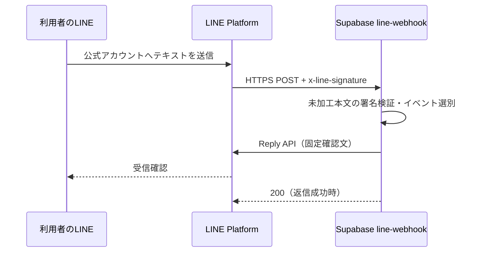

# LINE Messaging API接続準備の設計

## 基本情報

- 対象Issue: #58、ブランチ: `env/58`
- 状態: 合意済み（2026-11-18）
- 合意日・合意対象: 2026-11-18、設計・TODO全体、ADR 0013、ユーザーがDashboardで秘密情報を登録する担当案、設定前確認の条件を明示承認。要求書全体も同日合意済み。
- 検証方針の変更合意: 2026-11-18、ローカルDocker環境の整備が難航したため、ローカルSupabase起動・HTTP経路は未実施と記録し、開発用Supabaseへ関数をデプロイして正常署名・不正署名・署名なしと実LINE受信・返信を直接確認する案にユーザーが明示合意した。要求は変更しない。
- 正とする要求書: [requirements.md](requirements.md)

## 設計の概要

人間が最低限読む範囲は基本情報とこの節とする。後続サブエージェントは[詳細設計](#詳細設計)も読む。

### 全体構成

LINEからの通知を受け、記事保存に先立って接続だけを確認する。既存のSupabase非本番プロジェクトへ `line-webhook` Edge Function（サーバーで動く小さな処理）を追加し、LINE署名の検証後、1対1トークのテキストへ固定文を返信する。DBへの保存やアプリ認証は行わない。

通知と返信の経路を次に示す。Cloudflare Pages上の既存画面はこの経路に介在しない。

### 主要な設計判断と採用理由

- 既存ADRのサーバー処理配置に従いSupabase Edge Functionsを使う。LINEはSupabaseのログイン情報を送らないため、この関数だけJWT（Supabaseの認証トークン）検証を無効にし、LINE署名を入口の認証にする。公開入口の防御を関数で担う負担を受け入れる（[認証と受信](#認証と受信req-002)、[ADR 0013案](../adr/0013-authenticate-line-webhook-in-supabase-edge-function.md)）。
- 接続確認の返信は処理内で待ち、失敗をHTTP結果に反映する。永続キューは追加せず、外部API待機と再配信の制約を受け入れる。本格的な保存・通知処理の信頼性設計は後続で行う（[返信と失敗](#返信と失敗req-003)）。
- 秘密情報はユーザーがSupabase Dashboardへ直接登録する案とする。エージェントへの実値共有を必要とせず、設定操作と接続確認にはユーザーの作業が必要になる（[秘密情報と担当](#秘密情報と担当req-004req-005)）。

### 適用条件と運用上の制約

既存LINE公式アカウントのWebhookを変更すると現在の連携先へ通知されなくなる。既存用途、チャネル管理権限、対象のSupabaseプロジェクト・非本番用途・設定権限を[設定前の確認](#設定前の確認req-001req-005)で確認してから外部設定する。既存環境を利用できない場合は親エージェントへ相談し、別環境の作成や本番利用へ自動的に切り替えない。

今回は非本番での接続確認であり、実際のテキスト送信と返信到達が必要になる。コード・モックテストだけでは完了しない。既存の一般利用者への影響を避けられないアカウントは、そのまま設定対象にしない。

### 成立を確認した根拠と限界

2026-11-18に要求書、既存コード、設定、ADR 0002・0003、公式資料を点検した。`supabase/config.toml`はproject_idのみで、Webhook実装・関数用テスト設定は存在しない。既存画面は接続確認用テーブルの読取りのみ。DenoとDockerの実行ファイルはこの環境では見つからず、サーバーテスト実行環境の準備が必要である。

公式資料で、外部Webhookの独自署名認証、Edge Function Secrets、LINE側の設定経路と署名方式を確認した。実装後のDenoモックテスト・型・Lint・書式とフロントエンドのチェックは成功した（[TODOの実施記録](todo.md#ローカル実装の結果2026-11-18)）。ローカルSupabase起動・HTTP経路は未実施であり、Docker互換性の成功は確認していない。その後、非本番Supabaseへのデプロイ・LINE Verify成功・実トークの固定確認返信到達をユーザーが確認した。署名なし・架空署名は公開URLで401を実測した。正常署名の公開受信はLINE Verify成功を根拠とし、独自補助スクリプトによる正常空events 200の試験は未実施である。追加の設定確認結果と検証の限界、担当別の根拠は[TODOの公開確認結果](todo.md#公開環境の確認結果2026-11-18)に記録する。

### 人間の判断に関わる未決事項

- 本設計・TODO全体とADR 0013は2026-11-18に承認済み。
- ユーザーがLINEのチャネルシークレット・アクセストークンを取得し、Supabase Dashboardで登録する担当案は合意済み。取得・登録が難しい場合は方法・担当を決めるまで設定を止める。
- 既存LINEアカウントの開発用途への利用可否、Supabaseの対象プロジェクト・非本番用途・権限の確認結果。これらを設定開始の条件とすることは合意済み。結果自体は設定前に確認するため、ローカル実装を妨げない。

## 詳細設計

### 設定前の確認（REQ-001・REQ-005）

1. ユーザーがLINE Official Account Managerの対象アカウントでMessaging APIの有効状態・チャネルを確認する。既存チャネルがある場合はLINE Developers Consoleで対応する公式アカウント、プロバイダー、管理者権限を確認する。未有効ならOfficial Account Managerで有効化する。プロバイダー選択が後続の紐付けへ影響するため、所属が不明な場合は設定前に相談する。[LINEの開始手順](https://developers.line.biz/en/docs/messaging-api/getting-started/)
2. ユーザーが既存Webhook URL・Use webhook・応答設定・利用目的を確認する。既存連携がある場合は上書きせず影響と戻し方を相談する。検証中に自動応答と確認返信が混在しないよう、対象アカウントの応答メッセージ・あいさつ設定の変更可否を確認する。復旧用の従前値はユーザーが保持し、秘密情報や個人情報を記録へ転記しない。
3. Supabase Dashboardでユーザーがプロジェクトを選び、Project URLのproject-ref、非本番専用であること、本番データ・本番用秘密情報を利用しないことを確認する。共有環境なら既存関数名・LINE用変数名と用途の競合を確認する。
4. ユーザーがSecrets編集と関数デプロイを行える権限を確認する。公式資料上、リモートSecretsの作成・削除はOwner/Administrator権限が必要。確認記録には環境の識別名、非本番確認、操作可能な担当、確認日・判定だけを残す。秘密値、ユーザーID、トーク本文は残さない。[Supabase Secrets](https://supabase.com/docs/guides/functions/secrets)
5. 以上を満たした後、対象project-refを明示した関数デプロイを行う。既存DBマイグレーションを一括適用しない。設定時に方法・担当が未決、権限不足、用途の競合がある場合は依存作業を止める。

### 認証と受信（REQ-002）

公開URLは `https://<project-ref>.supabase.co/functions/v1/line-webhook`。`supabase/config.toml` の `[functions.line-webhook]` にだけ `verify_jwt = false` を設定する。Supabaseの公開キー・ユーザーJWTをLINEに渡さない。[Supabase外部Webhook認証](https://supabase.com/docs/guides/functions/auth#external-webhooks)

処理順序は次のとおりとする。

1. POST以外は405。必要なサーバー環境変数が欠ける場合は500とし、返信を行わない。
2. `x-line-signature`がない場合、Base64として不正な場合、検証不一致の場合は401。本文をイベントとして解釈せず、外部APIを呼ばない。
3. 本文を未加工のバイト列として読み、チャネルシークレットを鍵とするHMAC-SHA256をWeb Cryptoで検証する。JSON解析・再文字列化・改行変更は検証後にする。[LINE署名検証](https://developers.line.biz/en/docs/messaging-api/verify-webhook-signature/)
4. 署名検証後のJSONは `unknown` として解析し、トップレベルがオブジェクトで `events` が配列であることを確認する。不正JSON・不正な外枠は400。
5. `events: []` は200、返信なし。LINEのVerifyで使われる通知を受けられるようにする。[Webhook URL検証](https://developers.line.biz/en/docs/messaging-api/verify-webhook-url/)
6. 複数イベントを走査し、`type: message`、`source.type: user`、`message.type: text`、文字列のtext、空でない文字列のreplyTokenがあるものだけ返信する。未知のイベント、画像・スタンプ、グループ・複数人トーク、不足するイベント項目は無視し、返信なしなら200とする。受信テキストやsource.userIdは保存・出力しない。

### 返信と失敗（REQ-003）

選別したイベントのreplyTokenを使い `https://api.line.me/v2/bot/message/reply` へサーバー側からPOSTする。AuthorizationにはチャネルアクセストークンのBearer認証を用いる。返信文は「メッセージを受信しました。接続確認用の返信です。記事は保存していません。」とし、受信本文を含めない。[LINE Reply API](https://developers.line.biz/en/reference/messaging-api/#send-reply-message)

返信呼出しは5秒で中断し、アプリ側の自動再試行はしない。複数イベントはそれぞれの結果を確認し、1件でも返信失敗・タイムアウトがあれば502、対象すべてが成功した場合は200とする。結果のログは `reply_failed` など固定の分類とHTTPステータスだけにし、LINEの応答本文・例外全文・リクエスト内容は出さない。

接続確認ではWebhook再配信を有効にせず、失敗時は原因を確認して新しいテキストを送る。既に有効なら設定前に無効化の可否を相談する。replyTokenを再利用せず、重複排除用DBや永続キューは今回追加しない。配送重複・到達の一度限り保証はしない。[LINE受信と再配信](https://developers.line.biz/en/docs/messaging-api/receiving-messages/)

LINEは非同期処理を推奨しているが、本タスクでは短い固定返信だけを同期的に完了させる案である。タイムアウト時にLINEの受信タイミングとのずれや返信結果不明があり得るため、実トークでの確認と失敗記録を必須にする。保存や通知を追加する段階で応答時間・再試行・重複排除を再設計する。

### 秘密情報と担当（REQ-004・REQ-005）

サーバー専用の設定項目と担当案を次に示す。ユーザーが実値を取得・設定し、エージェントは変数名・手順・コードのみを整備する。

| 項目 | 取得元 | 設定先・担当案 |
| --- | --- | --- |
| `LINE_CHANNEL_SECRET` | LINE Developers ConsoleのBasic settings | 対象Supabase DashboardのEdge Function Secretsへユーザーが登録 |
| `LINE_CHANNEL_ACCESS_TOKEN` | 同チャネルのMessaging API設定 | 同上 |
| Webhook URL / Use webhook | 公開関数のURL | LINE Developers Consoleへユーザーが設定・Verify・有効化 |

接続確認用には既存の利用可能なトークンを優先し、新規発行が必要ならConsoleで取得できる長期トークンを使う案とする。有効期限がない分、手動の失効・更新が必要になる。LINE推奨の有効期限指定トークンの発行・更新自動化は#20の管理方式検討へ引き継ぐ。既存トークンの再発行やシークレット再発行は既存連携への影響を確認するまで行わない。[トークンの種類](https://developers.line.biz/en/docs/basics/channel-access-token/)、[LINE構築手順](https://developers.line.biz/en/docs/messaging-api/building-bot/)

実値は会話、コマンド引数、Git、Pages、`VITE_`変数へ入れない。ローカルテストは架空値のみを使い、実Secretsを必要としない。テンプレートを追加するなら `supabase/functions/.env.example` に変数名と空値だけを置く。`.gitignore`の`.env.*`は既に適用されるが、テンプレート例外と実値ファイルの除外を確認する。

アプリのログは固定結果分類・HTTPステータス・件数だけとし、本文、署名、replyToken、アクセストークン、LINEユーザーID、送受信オブジェクトを出さない。接続確認記録も日時、非本番環境の識別名、シナリオ、結果、確認担当だけにする。スクリーンショットや生のプラットフォームログの貼付けを根拠にしない。

### 成果物・変更範囲（REQ-002〜REQ-006）

- `supabase/functions/line-webhook/`: 起動入口、署名・イベント処理、Reply API通信、モックを使うテスト。入口から設定を読み、処理関数に設定・通信を渡せる構造にする。DBクライアントやLINE SDKは導入せず、Web Cryptoとfetchで足りる範囲に保つ。
- `supabase/config.toml`: 当該関数だけの認証設定。
- 関数用Deno設定と実行環境: strictな型チェック、テスト、Lint・書式を関数単位で実行できるよう整備。既存ESLintはブラウザ向けのため関数範囲を分離する。実行手段はDeno 2系をバージョン固定して開発環境へ追加し、ローカルSupabase起動・HTTP経路は今回未実施として記録する。実行環境との適合は開発用Supabaseへのデプロイと公開URL・実LINEで確認する。既存フロントエンドの型チェック・ビルドも維持する。
- `docs/development/line-messaging-api.md`: 設定前確認、権限、設定先、関数のデプロイ、Verify、有効化、各接続確認、障害時の戻し方、秘密情報の扱いを記載。READMEと既存セットアップ手順からリンクする。
- 手順書の後続対応: #20へアカウント紐付けとトークン運用、#8へ共有操作、#9へURL抽出・DB保存・保存完了返信を引き継ぐ。定期通知も未対応と明記する。署名検証済み受信処理と返信通信が再利用候補だが、本人のアプリユーザーとの対応は保証しない。
- `docs/env-58/todo.md`と後工程の`verification.md`: 実施結果と未実施事項を追跡する。

### 検証方針

ローカルでは実値を使わず、架空シークレットで本文の署名を作り、外部fetchを差し替える。テストを先に失敗させてから実装する。[Supabaseの関数テスト](https://supabase.com/docs/guides/functions/unit-test)

要求ごとの判定と、ローカル試験では保証できない部分を次に示す。

| 対象要求 | 自動確認・点検 | 公開環境で必要な確認 |
| --- | --- | --- |
| REQ-001 | 手順の対象環境・権限・競合条件を点検 | ユーザーによるアカウント・チャネル・権限・非本番確認 |
| REQ-002 | 正常署名、本文改変、誤鍵、署名なし、不正Base64、日本語・改行、空events、不正JSON、POST以外。拒否時fetchが0回 | Supabase認証情報なしの正常署名が200、不正・署名なしが401、LINE Verify成功 |
| REQ-003 | 1対1テキストだけ固定文返信、複数イベント、対象外、失敗・タイムアウトが502、再試行なし | 未ログインの実トークからテキスト送信し固定文の到達確認 |
| REQ-004 | 架空値のみ、ログ・エラー応答に秘密・本文・IDがないこと、ブラウザへのimportなし、Git対象差分・ビルド成果物を点検 | 秘密値を表示せず登録済みの確認、公開設定先に未設定であることを担当が確認 |
| REQ-005 | 別担当が実行順・期待値・停止条件を読み取れるか点検 | 設定手順を実施して日時・結果を記録 |
| REQ-006 | 手順書とREADMEの対応範囲・後続Issueの記述を照合 | なし |

公開URLへの署名試験ではユーザーの端末上で秘密を表示しない補助スクリプトを用意する。シークレットは非表示入力し、架空の空events本文へ署名する。正当・誤署名・署名なしの応答コードだけを表示する。実トーク確認は個人情報を含まない接続確認文で行い、ログインを要求しないこと、保存完了と誤認する文面でないことを確認する。

コード変更時は関数のテスト・型・Lint・書式、`pnpm exec tsc -b`・`pnpm lint`・`pnpm build`を実行する。ローカルDocker環境の整備が難航したため、ローカルSupabase起動・HTTP経路は完了の前提から外し、未実施と記録する。代わりに開発用Supabaseへ当該関数だけをデプロイし、表の公開署名試験・Verify・実トークを必須とする。Denoモックテストの結果は処理仕様の根拠として維持するが、Docker互換性や公開接続の成功を示すものではない。ツール不足や外部確認未実施を成功として扱わない。デプロイ前には関数設定と対象project-refを再照合する。

### 未決事項

設計・TODOと担当案は2026-11-18に明示合意済み。実装方法を左右する未決はない。既存外部環境の確認結果は設定ゲートで解消し、満たさない場合は設定と公開試験を止めて親へ返す。

## 関連資料・判断記録

- [要求書](requirements.md)・[TODO](todo.md)
- [ADR 0013案](../adr/0013-authenticate-line-webhook-in-supabase-edge-function.md)
- [ADR 0002](../adr/0002-use-supabase-for-backend-services.md)・[ADR 0003](../adr/0003-use-cloudflare-pages-for-frontend-hosting.md)
- [設計規約](../conventions/design.md)・[コーディング規約](../conventions/coding.md)・[既存セットアップ](../development/supabase-cloudflare-pages.md)
- 本文の公式一次資料は2026-11-18確認。サービス設定時にも対象画面と実際の権限・挙動を確認する。

### チーム参加・将来の接続先変更の手順補足（2026-11-18）

追加依頼はREQ-005・006の既存手順の補足として扱う。共有LINEチャネルへのAdmin招待、Official Account Managerの別権限、個人別検証で共有Webhookを変更しない運用を[接続手順](../development/line-messaging-api.md#他のメンバーが既存line連携へ参加する)へ追記した。

現接続先は個人用非本番Supabase `fbfmgiebxezryudfxnva`である。組織側の対象・方式は未決、切替は未実施とし、[別プロジェクトへの関数再配置とプロジェクト自体の組織移管](../development/line-messaging-api.md#個人用supabaseから組織側へ切り替えるとき)を区別した。関数再配置は移行先確認・Secrets直接登録・関数単独デプロイ・署名拒否確認・Verify・Webhook切替・実返信確認・結果記録・復旧と旧設定整理を扱う。DBを使わないLINE機能の移行手順であり、アプリ全体のDB/Auth/Pages移行は含めない。新たな技術選定やADR変更は行っていない。
